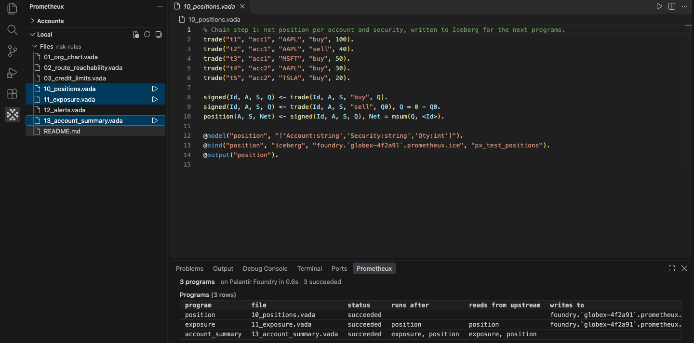
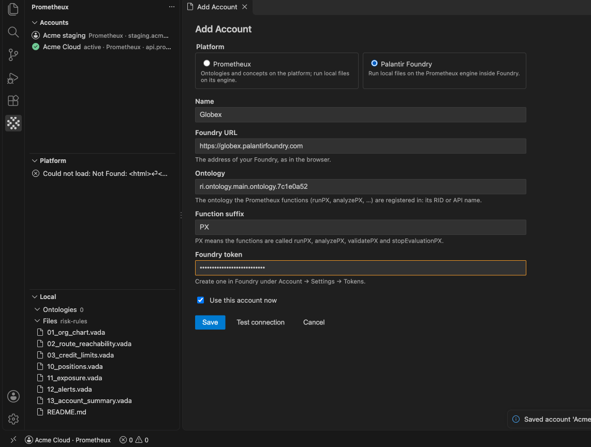
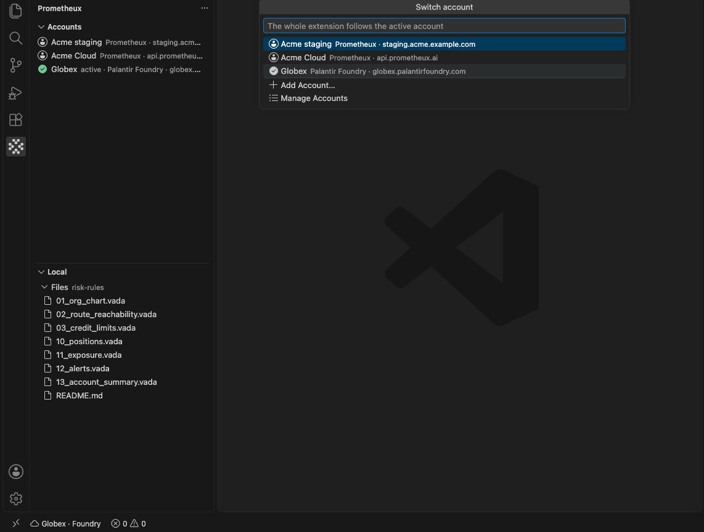

# Prometheux for VS Code

Write [Vadalog](https://docs.prometheux.ai) with full language support and run it on
[Prometheux](https://www.prometheux.ai) (Cloud, self-hosted / BYOC or a local backend) or on the
Prometheux engine inside **Palantir Foundry**. Browse and edit the ontologies and concepts on your
Prometheux platform without leaving the editor.

> **Preview.** Feedback and bug reports: [GitHub issues](https://github.com/prometheuxresearch/prometheux-vscode/issues).

**Run Vadalog files, alone or several together.** Select files and folders in the Prometheux view
and run them: a file that uses another's `@output` runs after it and reads the table it wrote;
the Results panel shows the order, timing and rows.



**One extension, many accounts.** Add accounts for every Prometheux platform and Palantir Foundry
you work with and switch between them from the status bar.





## Getting started

To install from a clone of this repository (needs Node.js 22+):

```bash
git clone https://github.com/prometheuxresearch/prometheux-vscode.git
cd prometheux-vscode
./install.sh        # builds the extension and installs it into VS Code (or Cursor / VSCodium)
```

Then reload the editor (`Cmd/Ctrl+Shift+P` → **Developer: Reload Window**) and:

1. Open the **Prometheux** view in the activity bar and click **Add Prometheux Account** or **Add
   Palantir Foundry Account** (see [Accounts](#accounts) for what each needs).
2. Open a folder with `.vada` / `.vadalog` files, or create one with **New Vadalog File**.
3. Press ▶ next to a file in **Local → Files**, or `Cmd/Ctrl+Shift+Enter` in its editor.

The extension needs a [trusted workspace](https://code.visualstudio.com/docs/editor/workspace-trust):
it sends the workspace's programs to the account you connect.

## What's in the Prometheux view

The **Prometheux** view in the activity bar has two parts, one per way of working:

- **Platform**: the ontologies on your platform, live. Concepts open as
  `prometheux:/<ontology>/<concept>.vada`; saving the editor saves the concept, and
  `Cmd/Ctrl+Shift+Enter` runs it, with live status and paged results in the
  **Prometheux → Results** panel. New, rename and delete work too. This is the web app's editing
  loop, in VS Code.
  Every concept type can be created and edited, each as a file in the same format `px pull`
  writes:

  | Type | File | Contents |
  | --- | --- | --- |
  | Logic | `.vada` | Vadalog rules |
  | SQL | `.sql` | the query |
  | Cypher | `.cypher` | the query |
  | Python | `.py` | a script whose `main(params)` returns the rows |
  | LLM | `.llm.md` | YAML front matter (`llmConfig`: `output_columns`, `provider`, `model`, …), then the prompt, with `{{concept}}` placeholders |
  | Context | `.context.yaml` | `contextMode: static` with `noteIds`, or `contextMode: dynamic` with `query`, `top_k`, `kinds` |
- **Local → Ontologies**: platform ontologies downloaded as files with **Download to Workspace**
  (the cloud icon on an ontology). The files are what `px pull` writes
  (`ontologies/<slug>/prometheux.yaml`, `concepts/*.vadalog`, …), so you can version them in git
  and push them back with **Apply to Platform** (the cloud-upload icon): it shows the `px plan`
  diff (concepts to create / update and the downstream re-runs) and, once you confirm, runs
  `px apply` for that ontology. px snapshots the ontology first, and concepts deleted locally are
  never deleted on the platform. **Show Changes** shows the diff only; **Update from Platform**
  pulls again. Saving a file in a downloaded ontology only changes the file; the first save
  reminds you to apply.
  Evaluating a concept file rebuilds the program the platform would run from its
  `.meta.yaml` files (`@param` / `@post` / `@mapping` / `@model`, input bindings, `@output`), and
  **your local files take priority**: concepts it depends on that are local Vadalog files are
  included from your files, recursively, with their data-source bindings. Only concepts with no
  local Vadalog body (SQL, Python, …) are read from their stored platform results. The concept's
  own output binding is left out, so a local evaluation never overwrites stored results. The
  assembled program is printed (credentials masked) in the **Prometheux** output channel.
- **Local → Files**: the workspace's files and folders, as in Explorer (`files.exclude` applies),
  with Vadalog actions: ▶ on a `.vada` / `.vadalog` file (or `Cmd/Ctrl+Shift+Enter` in its editor)
  sends the program to the active account's engine and shows its outputs. Select several files
  and folders (`Cmd/Ctrl`- or `Shift`-click) and right-click → **Run Vadalog** to run them together
  as modules. Nothing is saved on the platform. On a Palantir Foundry account this is the whole
  Local view; on a Prometheux account the downloaded **Ontologies** are listed above it. The
  extension adds nothing to VS Code's own Explorer.

Download, update and apply run the [px CLI](https://github.com/prometheuxresearch/prometheux-cli)
(`pipx install prometheux`) with the extension's connection; set `prometheux.pxPath` if `px` is
not on your PATH. Everything else works without it.

- **Language support** (from [Vadacode](https://github.com/bancaditalia/vadacode)): highlighting,
  hover, completion, signature help, go to definition, references, rename, outline, inlay hints,
  and "Test binding" / "Infer schema" code lenses on `@bind`, which now run on the platform.
- **Compute**: the status bar shows the compute pool machine your runs use. Click it for the
  machine list with live status, pick one, or start / stop machines from the list. Before a run,
  a stopped machine is offered to start. Hidden on platforms without compute pools (e.g. local
  development).
- **Validation on save** by the platform's own validator.
- **Notebooks** (`.pxnb`): Vadalog cells evaluated on the platform, results as tables.

## Accounts

Add an account for every platform you work with: Prometheux accounts (dev, staging, personal,
a customer's…) and Palantir Foundry accounts. **One account is active, and the whole extension
follows it**: the Platform view, the Local view, Run (▶ / `Cmd/Ctrl+Shift+Enter`), Run Vadalog on selections,
validation, notebooks and code lenses.

- **Add one**: **Prometheux: Add Account** (or `+` in the **Accounts** view). A form opens: pick
  the platform, fill in its fields, **Test connection**, **Save**.

  | Platform | URL | Token |
  | --- | --- | --- |
  | Prometheux Cloud | leave empty: worked out from the API key | API key (Settings → API keys) |
  | Prometheux self-hosted / BYOC | your platform's API URL (the SDKs' `JARVISPY_URL`) | API key from that platform |
  | Prometheux local development | `http://localhost:8000` | `devtoken` with `RUN_MODE=development` |
  | Palantir Foundry | e.g. `https://acme.palantirfoundry.com`, plus the ontology (RID or API name) the Prometheux functions are registered in | Foundry token (Account → Settings → Tokens) |

- **Switch**: click the account in the status bar, or **Use** in the Accounts view. The choice is
  kept per workspace (a repository can always open on its customer's account) and becomes the
  default for new windows.
- **Edit, test, delete** from the Accounts view.

Tokens are kept in VS Code's secret storage (the OS keychain), never in settings; the account
list is in the extension's own storage. An account's token is only ever sent to that account's
URL: changing the URL asks for the token again.

Accounts are also **detected**: the `JARVISPY_URL` + `PMTX_TOKEN` environment variables,
`~/.prometheux/config.json` from `px login` (`PROMETHEUX_HOME` is honoured), and
`FOUNDRY_URL` + `FOUNDRY_TOKEN` + `FOUNDRY_ONTOLOGY`. They show up in the list and can be made
active, but are edited where they come from.

On a Foundry account the Platform view is hidden (Foundry has no ontologies or concepts to
browse) and the compute selector too; everything about local files works the same.

The single-connection versions' sign-ins (`prometheux.apiUrl`, `prometheux.foundry.*`) become
accounts automatically the first time this version starts.

## Palantir Foundry

When the Prometheux engine runs inside Palantir Foundry (as a compute module, with the
`runPX` / `analyzePX` / `validatePX` / `stopEvaluationPX` functions published to an ontology),
you can write Vadalog files locally and run them there.

1. **Prometheux: Add Account** → Palantir Foundry: your Foundry URL (e.g.
   `https://acme.palantirfoundry.com`), the ontology the functions are registered in (RID or API
   name), and a Foundry token (Account → Settings → Tokens). Make it the active account.
2. In the Prometheux view → Local → **Files**, ▶ runs a file (as does `Cmd/Ctrl+Shift+Enter` in
   its editor); select several files or folders and right-click → **Run Vadalog** to run them together.
3. The **Results** panel shows a **Programs** table (each file's status, what it ran after, the
   tables it writes, rows and time) and the rows of every `@output` that came back.

**Several files run as modules** (on Prometheux accounts too), like the platform runs concepts: each file is one program, run
by its own engine call. A file that uses another file's `@output` runs after it and reads the
table that file writes: its `@bind` (and `@model`) for that predicate is added to the reading
file, unless the file binds it itself. Files that don't use each other's outputs run at the same
time (at most `prometheux.run.maxParallel`; Prometheux accounts run them one at a time). A failed
file skips the files that read from it.
Before anything runs, a file without `@output`, an output in two files, a cycle, or an output read
but written nowhere is reported by file name. The order and the programs as sent are in the
**Prometheux** output channel.

Validation (on save and **Validate**) uses Foundry's parser on a Foundry account.

An `@output` written to a table (`@bind`) comes back without rows: its rows are in that table.
Each file must finish within Foundry's 5-minute function limit.

To try it, run the [`samples/foundry-modules`](samples/foundry-modules) folder: three independent
programs and a chain of four (one reading from two), with the expected results in its README.

## Settings

| Setting | Default | |
| --- | --- | --- |
| `prometheux.run.mode` | `auto` | `single`, `auto` or `all`: how much of the dependency chain a run rebuilds. |
| `prometheux.results.pageSize` | `100` | Rows per page of concept results. |
| `prometheux.results.maxRows` | `1000` | Rows rendered per table for evaluated programs. |
| `prometheux.results.reveal` | `true` | Reveal the Results panel when a run starts. |
| `prometheux.validateOnSave` | `true` | Validate on the platform when saving. |
| `prometheux.languageServer.diagnostics` | `false` | Show the local language server's diagnostics (see below). |
| `prometheux.pxPath` | `px` | The px CLI, for downloading ontologies. |
| `prometheux.run.maxParallel` | `4` | Most files running at once on a Foundry account (Prometheux runs them one at a time). |

## Known limitations

- **Local diagnostics are off by default.** The language server's grammar comes from Vadacode
  (Banca d'Italia's Datalog±) and does not cover the whole Prometheux dialect yet: SQL rule
  bodies (`p(X) <- SELECT …`), `!` negation, `<>`, condition functions such as `contains(…)`,
  `X in {…}`, `#graph` options, 2-argument `substring`. Of the engine-verified programs in
  `test/dialect-corpus/`, 10 of 23 parse cleanly today (`npm run check:dialect`). Highlighting,
  hover, navigation and the platform validator work regardless.
- **The platform stores concepts normalized.** On save, `@output` and `@bind` annotations become
  the concept's bindings and the body is stored without them (comments are not kept either), the
  same as in the Prometheux app. The editor reloads to what was stored. Bindings are shown in the
  concept tooltip and managed in the app.
- **Machine selection with an API key.** Runs send the selected machine like the web app does
  (`compute.machine_configs.id`), but the platform only honours it for requests that also carry a
  Supabase session. With an API key it uses your most recently started running machine, so the
  selection is exact when one machine is running. Databricks clusters are not in the selector yet.
- **Local evaluation of a downloaded concept runs its whole local chain in one program.** Helper
  predicates that clash between concepts are renamed, and a concept read through fewer columns
  than it has gets an adapter rule (the platform reads its stored table's leading columns). The
  upstream concepts' `@post` annotations do not apply, since nothing is materialized.

## Development

Requires Node.js 22+. The TypeScript SDK is not on npm yet, so it is vendored as a tarball in
`vendor/`; `npm run sdk:update` rebuilds it from `../prometheux-chain-ts`.

```bash
npm install
npm run build              # dist/ (extension, language server, webviews)
npm run typecheck
npm test                   # unit tests: program assembly + language server (from Vadacode)
npm run test:integration   # real VS Code against JARVISPY_URL (default http://localhost:8000, devtoken);
                           # compute pool machines and px are faked (test/integration/fake*);
                           # PX_REAL=1 uses the real px CLI
npm run test:foundry       # accounts + Foundry in real VS Code against a fake Foundry (fakeFoundry.mjs), or
                           # against FOUNDRY_URL / FOUNDRY_TOKEN / FOUNDRY_ONTOLOGY when set
npm run check:dialect      # how much of the Prometheux dialect the grammar parses
npm run package            # build/prometheux-<version>.vsix
```

Press `F5` in VS Code to launch an Extension Development Host.

### Releasing

CI (`.github/workflows/ci.yml`) runs the typecheck, the unit and language-server tests, the
accounts / Foundry suite in a real VS Code and packages a `.vsix` on every push. To publish:

1. Update `version` in `package.json` and add its section to `CHANGELOG.md`.
2. `git tag v<version> && git push origin v<version>`.

`.github/workflows/release.yml` then checks again and publishes to the Visual Studio Marketplace
(`VSCE_PAT` secret: an Azure DevOps token with the *Marketplace → Manage* scope for the
`prometheux` publisher) and Open VSX (`OVSX_PAT` secret, `prometheux` namespace), and attaches
the `.vsix` to a GitHub release.

The parser in `parser/src/grammar/` is generated from `parser/grammar/Datalogpm.g4` and committed;
after changing the grammar run `npm run parser:generate` (needs Java; downloads ANTLR 4.13.1).

Layout:

```
src/            extension (connection, explorer, concept file system, runner, results, validation)
src/accounts/   accounts: model, storage (secrets in SecretStorage), Accounts view, add / edit form
src/foundry/    Palantir Foundry client (execute-query API for the gateway's functions)
src/run/        running local files: platform backends, module planning (as the runProgramsPX Foundry function)
src/vadacode/   client pieces adapted from Vadacode (language client, notebook, binding lenses)
server/         language server (from Vadacode)
parser/         ANTLR grammar and generated parser (from Vadacode)
syntaxes/       TextMate grammars
test/           integration suite and dialect corpus
```

## License

Based on Vadacode, Copyright (c) 2023-present Banca d'Italia, under the Server Side Public
License v1 (SSPL-1.0); see [LICENSE](LICENSE) and [NOTICE.md](NOTICE.md).
